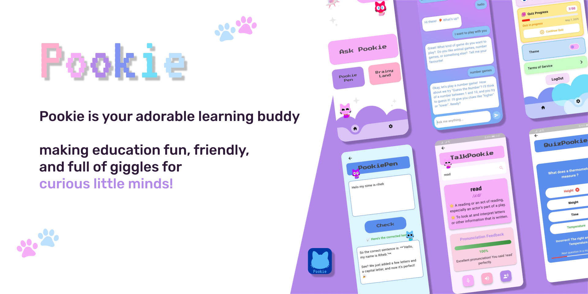
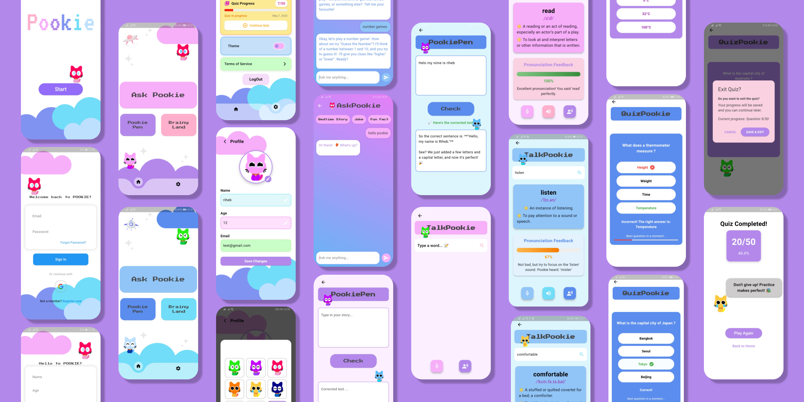

# Pookie AI Tutor App

AI-powered educational mobile app that helps children aged **6–12** learn languages through an AI chatbot, grammar correction, pronunciation practice, and interactive quizzes. The app supports both **English and Arabic** and provides a friendly, child-oriented learning environment.

> This repository contains the demo and documentation of the app.

## Demo





- Live demo: https://your-link-here
- Demo video: [Watch the demo](screenshots/demo.mp4)

## Features

- **Ask Pookie (AI Chatbot):** Kids practice languages by chatting with a friendly AI tutor.
- **Pookie Pen (Grammar Correction):** Analyses written text, detects errors, and provides simple, child-friendly corrections.
- **Talk with Pookie (Pronunciation Assistant):** Evaluates children's speech and provides pronunciation feedback.
- **Quizzy Pookie (Interactive Quizzes):** Fun questions help children test and reinforce what they have learned.
- **Bilingual learning:** Supports both English and Arabic.
- **Child-friendly interface:** Includes large icons, readable fonts, playful visual elements, and theme options (pink/purple and blue).
- **Progress tracking:** Stores quiz sessions and scores to help follow learning progress.

## How it works

1. The child chats with Pookie and writes or speaks in English.
2. Mistakes in spelling and pronunciation are detected and corrected with clear, kid-friendly feedback.
3. Quizzes check progress and help the child remember new words.

## Tech stack

| Area | Technology / Purpose |
|---|---|
| Mobile application | **Flutter** — cross-platform mobile app development |
| Authentication | **Firebase Authentication** |
| Database | **Cloud Firestore** |
| Chatbot and text correction | **Google Gemini APIs** |
| Pronunciation evaluation | **Hugging Face APIs** |
| UI/UX design | **Figma** |
| Version control | **Git and GitHub** |
| Diagrams | **Draw.io** |

## Application design

The application design documentation includes the use case diagram, UI/UX mockups, client-server communication sequence diagram, and database design.

- [Use Case Diagram](docs/diagrams/use_case_diagram.png)
- [Client-Server Communication (Sequence Diagram)](docs/diagrams/sequence_diagram.jpg)
- [Database Design (MCD / Class Diagram)](docs/diagrams/database_design_diagram.jpg)

Update these relative paths if the diagrams or mockups are saved under different filenames or folders.

## Data management

The database structure and entity relationships are documented in the [Database Design (MCD / Class Diagram)](docs/diagrams/database_design_diagram.jpg)

## Getting started

Before running the project, make sure you have Flutter and Dart installed and that you have access to the Firebase project configuration and the required Gemini and Hugging Face API credentials. Keep private API keys and credentials out of the repository.

```bash
git clone https://github.com/your-username/pookie-ai-tutor-app.git
cd pookie-ai-tutor-app
# add installation and run instructions here
```

## Project structure

```
pookie-ai-tutor-app/
├── README.md
├── screenshots/
└── docs/
```

## Author

- Riheb Talhi: Master's student in Artificial Intelligence and its Applications, USTO-MB.
- Narimene Derkaoui: Master's student in Artificial Intelligence and its Applications, USTO-MB.

## License

_Choose a license (e.g. MIT) or remove this section._
